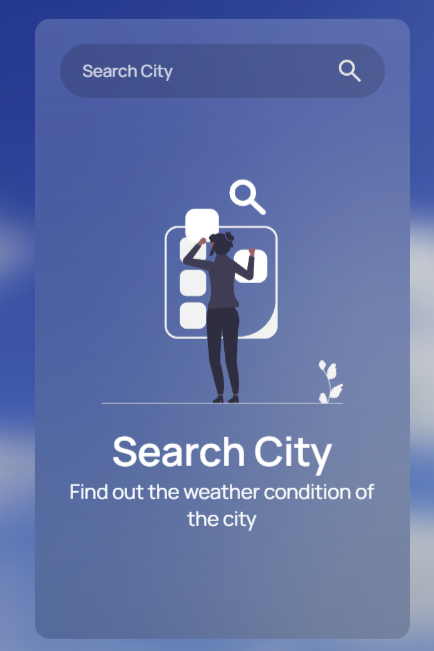
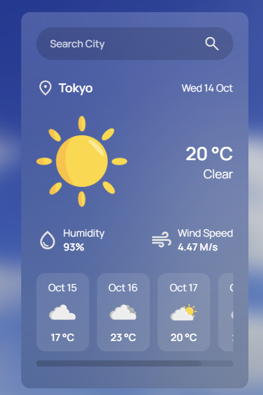
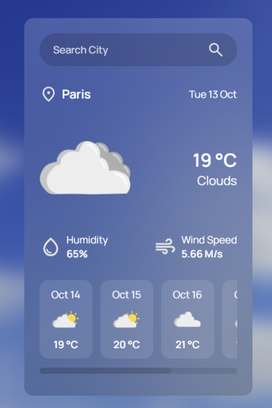
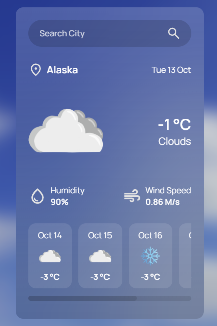

# 🌤️ Weather App

A clean and responsive Weather Application built with HTML, CSS, and Vanilla JavaScript. It fetches real-time weather data and 5-day forecasts using the OpenWeatherMap API, with accurate local time zone support for any city around the world.

---

## ✨ Features

- **Live Weather Updates:** Displays current temperature, weather conditions, humidity, and wind speed for any city.
- **Time Zone Synchronization:** Automatically calculates and displays local dates and daily forecasts adjusted to the selected city's timezone.
- **5-Day Weather Forecast:** Shows upcoming weather trends at 12:00 PM local time.
- **Dynamic Icons:** Features custom weather icons corresponding to current weather conditions.
- **Error Handling:** Clean user feedback when searching for invalid city names.
- **Responsive Layout:** Designed to work smoothly on both desktop and mobile devices.

---

## 🛠️ Built With

- **HTML** – Markup structure
- **CSS** – Custom styling & layout
- **JavaScript** – Asynchronous API handling (`fetch`, `async/await`), time calculations, and dynamic DOM manipulation
- **[OpenWeatherMap API](https://openweathermap.org/)** – Weather data provider

---

## 🚀 Getting Started

To run this project locally on your machine, follow these simple steps:

### Prerequisites

You will need an API key from OpenWeatherMap:
1. Sign up for a free account at [OpenWeatherMap](https://home.openweathermap.org/users/sign_up).
2. Generate your personal API Key from your account dashboard.

### Installation & Setup

1. **Clone the repository:**
   ```bash
   git clone https://github.com/PommeChxrry/WeatherApp.git

2. **Navigate to the project folder:**
    ```bash
    cd WeatherApp
    ```

3. **Configure your API Key:**
Open script.js (or your config.js file) and replace apiKey with your actual OpenWeatherMap API key:
    ```Javascript
    const apiKey = "your-api-key";
    ```

4. **Launch the app:**
Open the index.html file in your browser, or use a live server extension (like VS Code Live Server).

## 📸 Preview
<p align="center">
  
  
  
  
</p>

## 👤 Author
- Sydalia SM
- GitHub: [@PommeChxrry](https://github.com/PommeChxrry)
